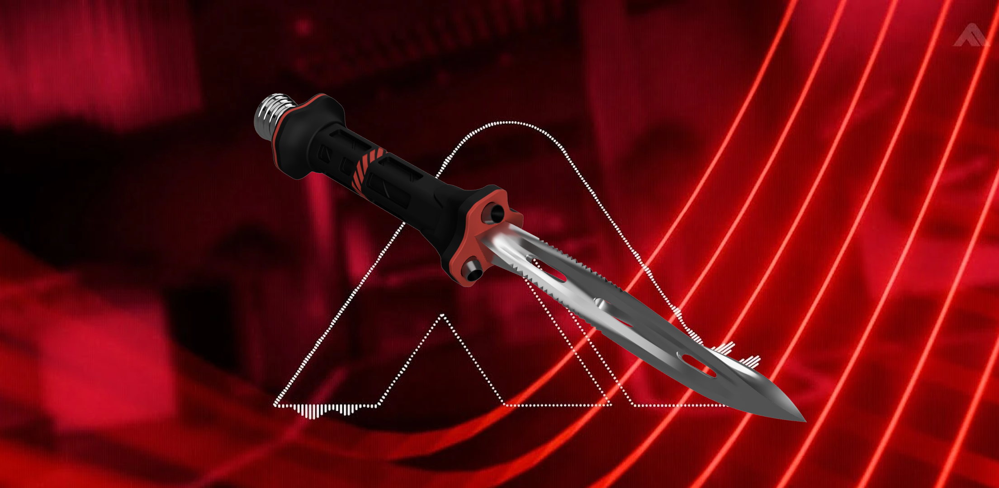
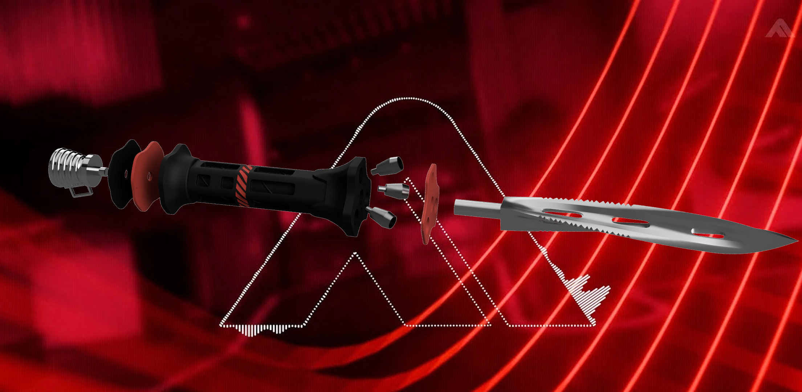

# The Finals - Recoilless Blade Dagger

Recoilless Blade dagger cosplay prop from *The Finals*, split into parts for easy printing and painting.

## Split for easy assembly

- Use 1.75 mm filament as pins to keep the segments lined up
- Pegs and holes have 0.15 mm clearance for glue
- Red parts are separate for easy painting

## Parts

- 1x Blade
- 1x Body
- 1x Guard_Ring (red)
- 1x Collar_Ring (red)
- 1x Collar_Plate (includes the pommel ring)
- 3x Thruster
- 1x Pommel_Nozzle (includes the charm loop)
- 1.75 mm filament for alignment pins
- Super glue
